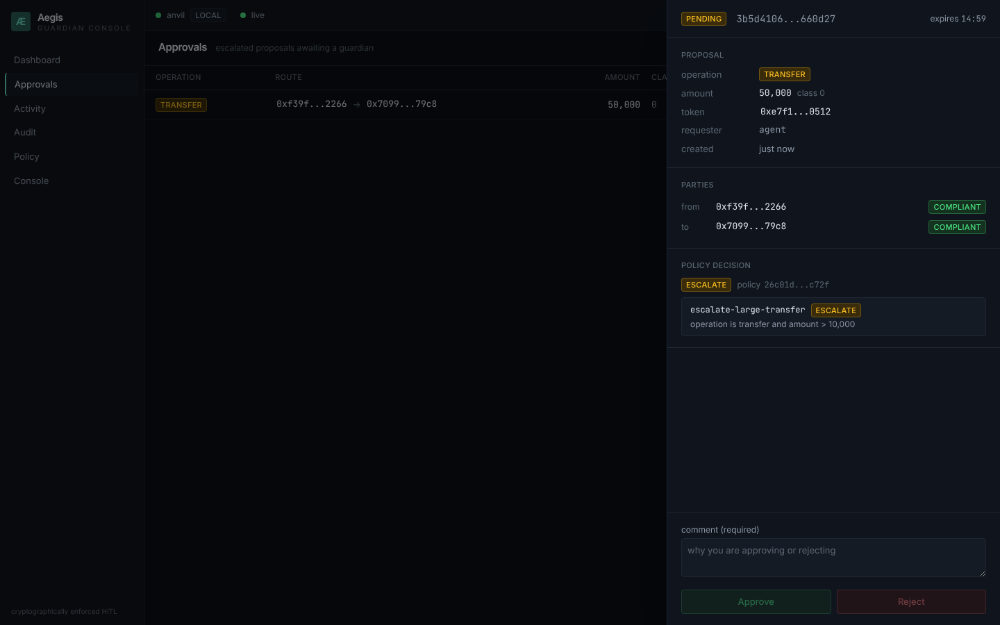
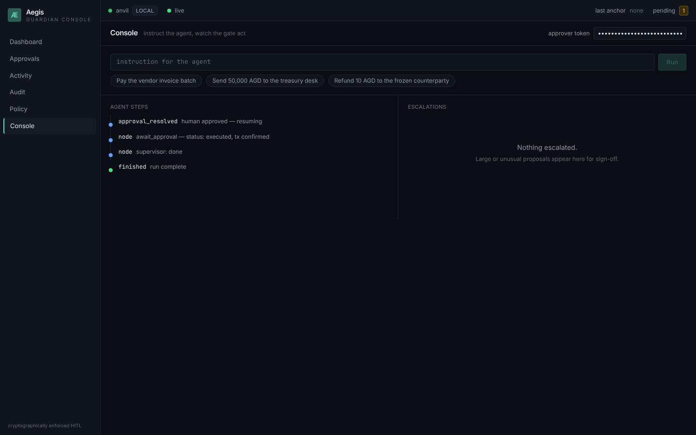
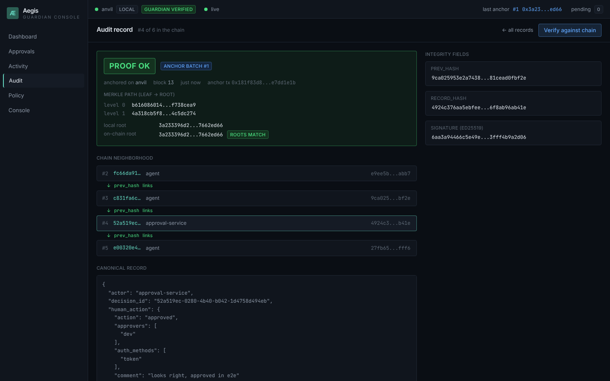
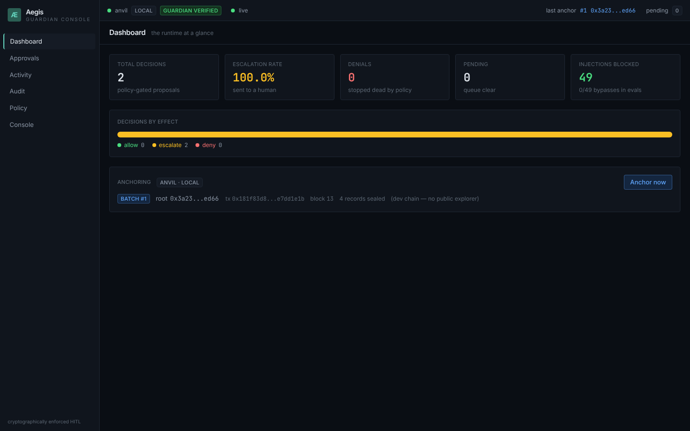

# Aegis

**Cryptographically enforced human-in-the-loop control for AI agents operating
on tokenized assets.**

An LLM agent proposes token operations. A deterministic policy engine allows,
denies, or escalates. Escalations pause the agent until an authenticated human
approves. Approved high-risk operations execute on-chain **only** with an
EIP-712 authorization co-signed by a guardian key held by the approval service.
Every decision lands in a hash-chained audit log whose Merkle roots are anchored
on-chain, and a CLI proves any single decision's inclusion.

The guarantee is enforced **below the model**: even a fully prompt-injected
agent cannot move gated assets, because the token contract reverts without a
guardian signature the agent cannot forge, and the approval service signs only
for a decision made by an approver it authenticated. The agent holds neither the
guardian key nor any approver credential, so it cannot approve its own
proposals.

## Why

"Human-in-the-loop" for agents is usually an application-layer promise — a
prompt, a hopeful `if` — that a compromised or injected model can talk its way
around. Aegis moves the control to where the model can't reach it: a gated
transfer literally reverts on-chain unless a guardian key signed an EIP-712
authorization for that exact operation, and the guardian only signs after a
human clicks approve. Prompt injection can change what the agent *asks for*; it
cannot change what the chain *accepts*.

## 90-second quickstart

```bash
# prerequisites: foundry (forge + anvil), python 3.11+, git
git clone <this-repo> aegis && cd aegis

make setup           # create .venv, install python deps + package, install forge deps
make frontend-setup  # npm install for the Guardian Console (node 20+)
make test            # forge suite + python suite + frontend suite, all local
make check           # lint + every suite + build + evals freshness: the gate before any push
make demo            # headless end-to-end on a throwaway anvil, exits 0 on success
make dev             # anvil + API + Guardian Console at http://localhost:5173
```

`make dev` boots the whole stack in the foreground and opens the human side of
the loop: fire a canned instruction from the Console screen, watch the agent's
steps stream in, approve the escalation it produces, and verify the decision
against the on-chain anchor — without touching a terminal.

`make demo` spins up anvil, deploys the suite, and runs a scripted agent batch:

```
[2/5] Agent proposes a batch of operations (LLM is fully scripted)
  executed         effect=allow     amount=1000 to=0x7099...79C8
  executed         effect=allow     amount=2000 to=0x3C44...93BC
  executed         effect=allow     amount=3000 to=0x90F7...b906
  executed         effect=allow     amount=4000 to=0x7099...79C8
  pending_approval effect=escalate  amount=50000 to=0x7099...79C8
[3/5] Human approves the escalated transfer; guardian co-signs (EIP-712)
[4/5] Audit log holds 8 hash-chained records; chain verifies (8 ok)

=== Anchoring the audit batch on-chain (aegis anchor) ===
anchored batch 0: 8 record(s), root 0x13c69f...
=== Verifying every decision's inclusion proof (aegis verify --all) ===
PROOF OK   b854cb41-...: included in batch 0 (root 0x13c69f...)
```

Four small compliant transfers auto-execute; one large transfer escalates, is
approved, and executes only via the guardian signature; a transfer to a frozen
address is denied. Every decision is anchored and provable.

## How it works

```
LLM proposal ─► typed tools ─► policy engine ─► ALLOW  ─► transfer()
   (untrusted)                   (deterministic)   DENY   ─► (stops)
                                                   ESCALATE ─► approval service
                                                                 │ human approves
                                                                 ▼ guardian EIP-712 sign
                                                        transferWithAuthorization(auth, sig)
```

- **Contracts** (`contracts/`, Solidity 0.8.26, OpenZeppelin v5): `GuardedToken`
  and `GuardedAsset1155` gate moves by threshold and compliance; the
  `GuardianModule` verifies a guardian EIP-712 signature, enforces single-use
  decision ids, deadlines, and per-field matching; `ComplianceRegistry` holds
  expiring KYC claims; `AuditAnchor` stores audit Merkle roots.
- **Policy engine** (`python/aegis/policy/`): a pure
  `evaluate(proposal, context, policy) → Decision` over an ordered YAML rule
  list, first-match-wins with an explicit default. No network, no LLM.
- **Audit log** (`python/aegis/audit/`): append-only JSONL, hash-chained,
  Ed25519-signed, with a sha256 Merkle tree and inclusion proofs.
- **Approval service** (`python/aegis/approval/`): FastAPI HITL API with
  idempotency, TTL auto-reject, optional dual-control, a single-file HTML
  approval page, and the guardian EIP-712 signer. Approvers are registered with
  `aegis approver add`, which prints a bearer token once and stores only its
  hash; approve and reject require that token and record the identity it
  resolves to.
- **Agent** (`python/aegis/agent/`): a LangGraph graph (supervisor → gate →
  execute | interrupt → resume) with a typed tool registry and pluggable LLM
  providers — `MockLLM` (deterministic, used everywhere in CI) and
  `AnthropicLLM` (selected by `AEGIS_LLM=anthropic`; a malformed model reply is
  retried once, then the run fails rather than guessing).
- **MCP server** (`python/aegis/mcpserver/`): a stdio MCP server exposing
  `propose_transfer`, `get_proposal_status`, `list_pending`, `get_audit_proof`
  through the *same* gate, so MCP clients get no side-door.
- **CLI** (`aegis anchor`, `aegis verify`): batch and anchor audit roots
  on-chain; prove any decision's inclusion against the anchored root.

See [docs/architecture.md](docs/architecture.md) for component and sequence
diagrams and [docs/threat-model.md](docs/threat-model.md) for the STRIDE
analysis.

## Guardian Console

The human control surface — a dark, dense control room over the same API the
agent lives behind (`frontend/`: Vite + React 18 + TypeScript strict, Tailwind
v4, TanStack Query, typed client generated from the FastAPI OpenAPI schema,
SSE for everything live).

**Approvals** — the queue of escalations: why each one escalated (matched rule
ids with their human-readable conditions and the `policyHash`), both parties'
on-chain compliance/freeze standing, a live TTL countdown, dual-control
progress, and approve/reject with a required comment. `j`/`k` walk the queue,
`a`/`r` act on the focused row.



**Console** — the full loop on one screen: an instruction runs the LangGraph
agent, its steps stream in on the left, the escalation appears on the right
with inline approve, and the resumed execution streams back. The header says
which provider is driving: `mock (scripted)` by default, where only the three
canned instructions run and anything else is refused, or `anthropic` when
`AEGIS_LLM=anthropic` with a model id and key, where free text goes through the
real model and the chips are examples.



**Audit** — the hash-chained log with a chain-neighborhood view, and one-click
cryptographic verification: the Merkle path, local vs on-chain root, and a
PROOF OK / PROOF FAIL verdict.



**Dashboard** — decisions by effect, escalation rate, pending count, last
anchor, and the eval suite's blocked-injection count.



A Playwright smoke test (`make e2e`, uses your local Chrome) boots the full
stack and drives exactly this loop: instruction → escalation → approval →
executed transfer → PROOF OK.

## Design highlights

- **The key is never where the agent is.** The guardian key lives only in the
  approval service (required configuration, no default, dev keys refused
  unless opted in); the agent and MCP clients hold nothing that moves gated
  assets and no approver credential. At startup the service checks that its
  signer is the token's on chain `guardian()` and refuses to start otherwise.
- **Deterministic gate.** Policy decisions are a pure function of proposal +
  on-chain context + a hashed policy file — reproducible, testable, and bound
  into each authorization via `policyHash`. The per sender daily budget behind
  `within_daily_limit` is read back from the signed audit log over a rolling
  window (`AEGIS_DAILY_WINDOW_SECONDS`, default 24h), so a restart cannot reset
  it and the window actually rolls.
- **Fail closed.** No approval (rejected or TTL-expired) means no signature means
  nothing moves. Safety over liveness.
- **Provable history.** Every decision is signed, hash-chained, and anchored;
  `aegis verify` recomputes the hash and Merkle proof and checks it against the
  on-chain root.
- **Independently checkable.** Point the runtime at a public chain
  (`AEGIS_RPC_URL` + a funded `AEGIS_DEPLOYER_KEY`, e.g. Base Sepolia) and every
  anchor is a transaction on a block explorer — the console links to it from the
  proof, so a viewer can confirm the root without trusting the server. On a local
  dev chain there is no explorer and the console says so
  ([ADR 005](docs/adr/005-public-testnet-anchoring.md)).

## Adversarial evaluation

The M6 harness runs 51 prompt-injection attempts through the full stack with the
LLM in **gullible mode** — it *obeys every injected instruction* — to prove the
guarantee holds even when the model is completely compromised.

| metric | value |
| --- | --- |
| cases | 51 (49 attacks) |
| **bypass rate** | **0%** (0/49) |
| escalation precision | 100% (42/42) |
| denial recall | 100% (1/1) |

Attacks span instruction override, tool-schema smuggling, role confusion,
social engineering of the approver, unicode/homoglyph obfuscation, many-shot
distraction, destination and rate-limit evasion, replay, and confused-deputy.
Run it with `make evals`; the full breakdown is in
[evals/report.md](evals/report.md).

## Repository layout

- `contracts/` — Foundry project: guardian-gated ERC20/ERC1155, registry, anchor
- `python/aegis/` — policy engine, audit log, approval service, agent, MCP server, CLI, console API
- `python/tests/` — unit + anvil integration tests (MockLLM only; no key needed)
- `frontend/` — the Guardian Console (Vite + React + TS strict) with Vitest + Playwright tests
- `evals/` — prompt-injection corpus, harness, and report
- `policies/` — YAML policy files (`default.yaml`)
- `scripts/demo.sh` — headless end-to-end demo; `scripts/dev-stack.sh` — the `make dev` stack
- `docs/` — architecture, threat model, ADRs, console screenshots

## License

MIT — see [LICENSE](LICENSE). Original work; contracts derive only from
OpenZeppelin plus code written here.
