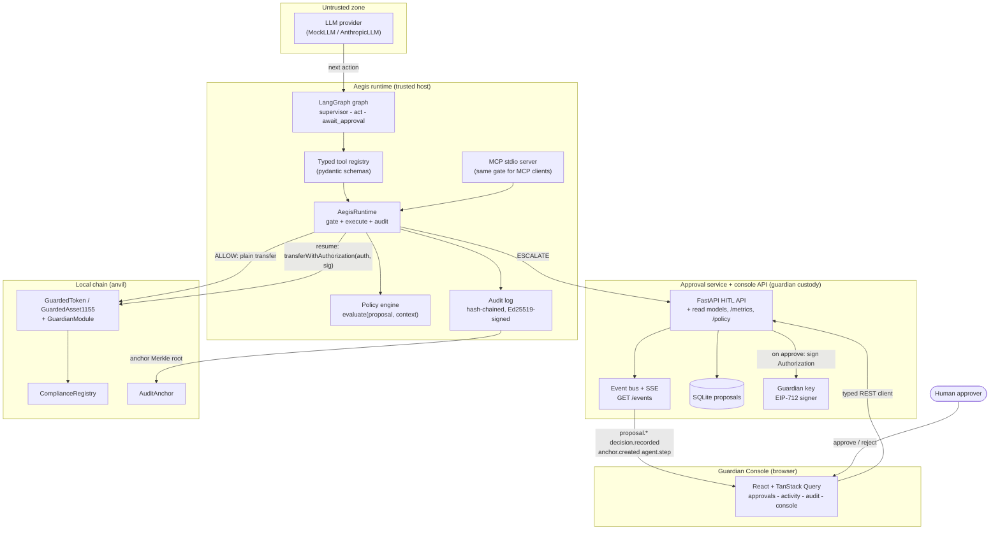
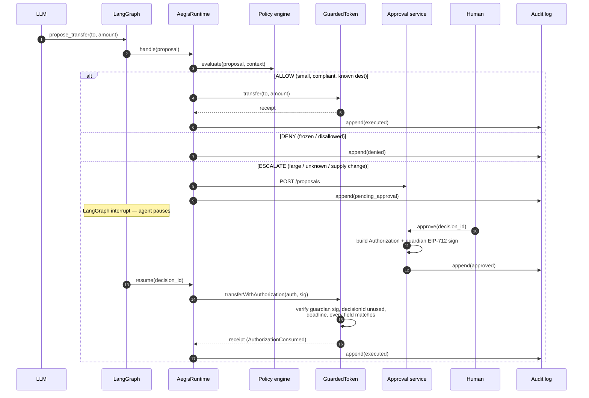

# Aegis architecture

Aegis enforces human-in-the-loop control over an AI agent operating on tokenized
assets **cryptographically, at the smart-contract layer** — not as an
application-layer promise. An LLM proposes token operations; a deterministic
policy engine allows, denies, or escalates; escalations pause the agent until a
human approves; approved high-risk operations execute on-chain **only** with an
EIP-712 authorization co-signed by a guardian key. Every decision is written to
a hash-chained, signed audit log whose Merkle roots are anchored on-chain.

The load-bearing idea: **the guarantee lives below the model.** Even a fully
prompt-injected agent cannot move gated assets, because the token contract
reverts without a guardian signature it can only obtain through the approval
service, which only signs after a human approves.

## Components

- **LLM provider** — the only untrusted component. Behind one interface:
  `MockLLM` (deterministic, used by every test and the demo) and the optional
  `AnthropicLLM`. Its output is *only* a proposed tool action; it never holds a
  key or touches the chain.
- **Typed tool registry** — pydantic schemas for `propose_transfer`,
  `propose_mint`, `check_compliance`, `get_balance`. Unknown tools and malformed
  arguments are refused before any logic runs.
- **Policy engine** — a pure function `evaluate(proposal, context, policy) →
  Decision {ALLOW | DENY | ESCALATE}` driven by an ordered YAML rule list,
  first-match-wins, with an explicit default. Deterministic; no network, no LLM.
- **AegisRuntime** — the trusted seam between the LLM and the chain. Gates every
  proposal, executes ALLOWs, routes ESCALATEs to the approval service, and
  audits every decision.
- **Approval service** — FastAPI app holding the guardian key. On human
  approval it builds the exact `Authorization` struct and signs it EIP-712.
- **Contracts** — `GuardedToken`/`GuardedAsset1155` gate transfers by threshold
  and compliance; the `GuardianModule` verifies the guardian signature, enforces
  single-use decision ids and deadlines, and checks every struct field against
  the actual call. `AuditAnchor` stores Merkle roots of audit batches.
- **MCP server** — a stdio server exposing the runtime to any MCP client through
  the *same* gate, so there is no privileged side-door.
- **Console API + event bus** — `aegis.api` extends the approval service (one
  process, one store, one audit log) with read models (`/decisions`,
  `/audit/records`, `/audit/verify/{id}`, `/policy`, `/metrics`,
  `/compliance/{address}`), `POST /agent/run` for keyless canned agent runs,
  and an in-process event bus streamed to the browser as SSE (`GET /events`):
  `proposal.*`, `decision.recorded`, `anchor.created`, `agent.step`.
- **Guardian Console** (`frontend/`) — the human control surface: a typed
  OpenAPI client for every read/write, TanStack Query caches invalidated by
  the SSE stream (no polling), and screens for the approvals queue, live
  activity, audit chain + Merkle verification, policy, and a command console
  that shows the whole instruct → escalate → approve → execute loop on one
  screen. The browser holds no keys; approving is an authenticated intent the
  service turns into a guardian signature server-side.

## Decision sequence

If the human rejects (or the 15-minute TTL expires), the proposal resolves as
rejected/expired, the agent resumes without a signature, and nothing moves.

## The guarantee, precisely

A gated move (`amount > threshold`, or either party non-compliant/frozen)
reverts with `GuardianRequired()` on the plain `transfer` path. The only other
path is `transferWithAuthorization`, which consumes an `Authorization` that:

1. is signed by the **current guardian** (rotation is admin-only);
2. carries a **single-use `decisionId`** (replay-proof);
3. is within its **deadline**;
4. matches **every call parameter** (token, from, to, id, amount, operation).

The agent never possesses the guardian key. The approval service produces a
signature only after a human approves. Therefore no prompt injection, tool
smuggling, or role-confusion attack in the LLM layer can move gated assets — a
property the M6 adversarial evals demonstrate with a bypass rate of 0.

## Audit and proof

Each decision becomes an append-only JSONL record: `decision_id`, timestamp,
actor, proposal, policy result, optional human action, `prev_hash`, a
`record_hash = sha256(canonical_json)`, and an Ed25519 signature. Records chain
by `prev_hash`, so mutating any record breaks every subsequent link.

`aegis anchor` batches unanchored records, builds a Merkle tree (sha256, sorted
pairs, duplicate-last for odd counts), and anchors the root on-chain in
`AuditAnchor`. `aegis verify <decision-id>` recomputes the record hash, rebuilds
the Merkle proof, fetches the batch root over RPC, and prints `PROOF OK` only if
the record is untampered *and* included under the anchored root.

## Trust boundaries

| Boundary | Untrusted side | Trusted side | Enforced by |
| --- | --- | --- | --- |
| LLM → runtime | LLM output | typed tools + policy | schema validation, deterministic evaluate() |
| runtime → chain | proposed op | consumed authorization | `GuardianModule` signature + field checks |
| approval → chain | proposal | guardian signature | EIP-712 over the exact struct |
| audit → verifier | JSONL file | anchored root | hash chain + Merkle proof vs on-chain root |

See [threat-model.md](threat-model.md) for the STRIDE analysis and residual
risks, including the malicious/compromised-LLM and prompt-injection cases.
